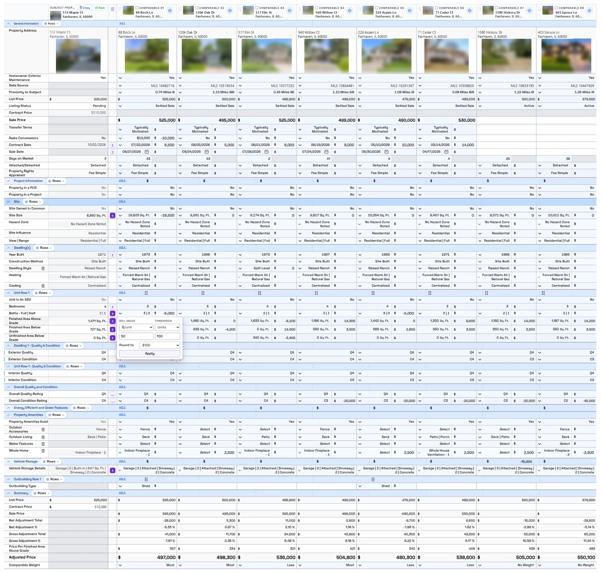
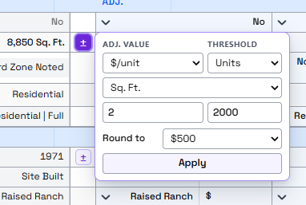

# Aivre Readability

A free user style that makes the [Aivre](https://www.aivre.com) appraisal software easier to read, especially the Sales Comparison grid.

*Unofficial. Not made by or affiliated with Aivre. It only changes how pages look in your own browser. It never changes your report data.*

## What it does

**On every Aivre page**
- Tiny text gets bigger and light gray text gets darker.

**In the Sales Comparison grid**
- Grid text is larger and heavier, and row labels are bold.
- Grid lines are stronger, and every other row is lightly shaded.
- The gray gap rows between sections are removed.
- **Sale Price** (top of the grid) and **Adjusted Price** (bottom) are larger, so the numbers that matter stand out.
- **Auto Adjustment becomes a floating panel.** Aivre normally stacks the auto adjustment controls inside each row, which makes rows 100 to 220 pixels tall. This style shrinks that column to a slim strip of small **±** buttons. Hover over one and the controls open in a card next to it, so the grid keeps its normal height.
  - A **solid purple ±** means an adjustment rate is set for that row.
  - An **outlined ±** means no rate is set.
  - A **…** button opens Configure (Overall Quality and Overall Condition).
  - Near the bottom of the screen, the card opens upward so it isn't cut off.

*Screenshots use fake addresses and MLS numbers, and the photos are blurred.*

## Install (about 2 minutes)

You need **Google Chrome** or **Microsoft Edge**. The floating panel uses a browser feature that other browsers may not support yet.

### 1. Add Stylus to your browser

Stylus is a free, open source extension that applies custom styles to websites.

Open [Stylus in the Chrome Web Store](https://chromewebstore.google.com/detail/stylus/clngdbkpkpeebahjckkjfobafhncgmne), click **Add to Chrome**, then confirm.

Using Edge? Open the same link. Edge shows a banner at the top: click **Allow extensions from other stores**, then **Get**.

### 2. Install the style

Open this link:

**[Install Aivre Readability](https://raw.githubusercontent.com/PairedSales/aivre-readability/main/aivre-readability.user.css)**

Stylus opens an install page with the style's code on it. Click **Install style** at the top left.

### 3. Open Aivre

Go to Aivre and open any report. If a report was already open, reload the page. The new look applies right away.

## Updates

Stylus checks for new versions on its own. To check now, click the Stylus icon in the toolbar, then **Manage**, then **Check for updates**.

## Turn it off or remove it

- **Turn off for now:** click the Stylus icon while on Aivre and uncheck **Aivre Readability**.
- **Remove:** click the Stylus icon, choose **Manage**, then click the trash icon next to Aivre Readability.

## Notes

- If Aivre changes its page layout in an update, parts of this style may stop applying. In that case Aivre simply looks the way it normally does. Nothing breaks.
- If something looks wrong, [open an issue](https://github.com/PairedSales/aivre-readability/issues) and include a screenshot. Remove any client or property details from the screenshot first.

## Manual install (if the link doesn't work)

1. Click the Stylus icon in your browser toolbar, then **Manage**.
2. Click **Write new style**.
3. Open [aivre-readability.user.css](aivre-readability.user.css), click **Raw**, and copy everything.
4. Paste it into the Stylus editor, replacing anything there, and click **Save**.

Styles installed this way don't auto-update. Repeat these steps to get a new version.

## License

[MIT](LICENSE)
